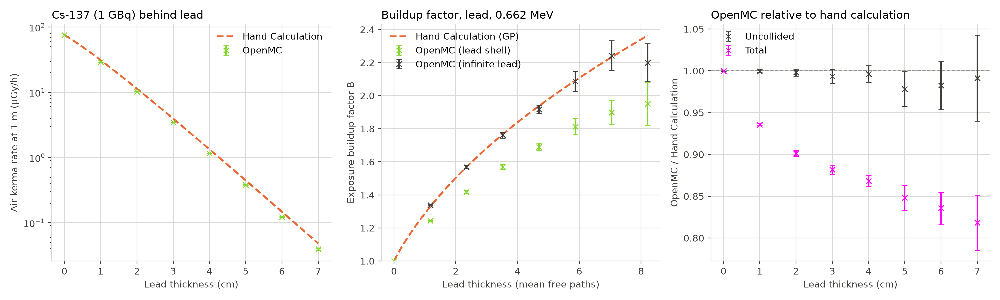
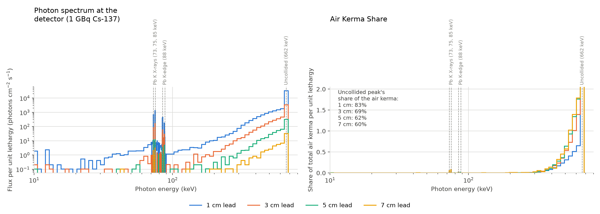
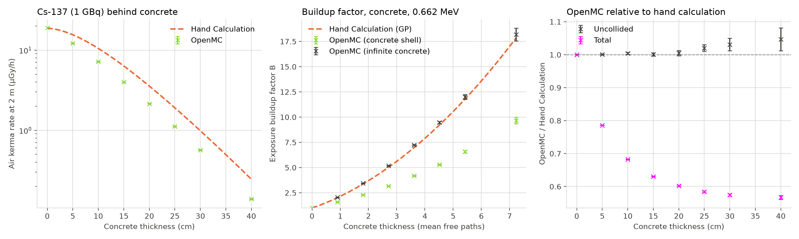
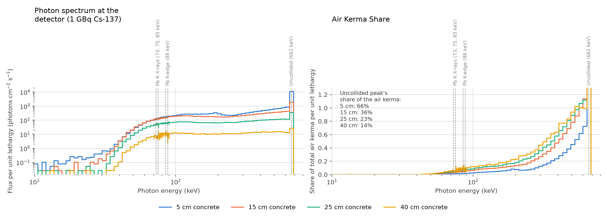

# Gamma-ray shielding: point-kernel vs Monte Carlo (Cs-137 behind lead)

A comparison of a hand point-kernel calculation, using geometric-progression (GP) buildup factors, against a Monte Carlo photon transport model in [OpenMC](https://docs.openmc.org/), for a Cs-137 point source behind a spherical lead shield.

The aim is to validate the Monte Carlo model against simple physics, then use it to test the assumptions built into the hand method, in particular the **infinite-medium assumption behind tabulated buildup factors**.

**Key findings (lead thicknesses 0–7 cm, up to 8.2 mfp):**

- **Uncollided air kerma agrees** between OpenMC and the hand calculation at every thickness, within about 1σ (OpenMC/hand = 0.978–1.000). This validates the geometry, source, normalisation and response function.
- **For a finite lead shell, OpenMC gives a lower buildup factor than the GP formula,** and the gap grows with thickness: 6 % lower at 1 cm, rising to 15 % lower at 6 cm. The point-kernel hand calculation therefore **overestimates the total air kerma rate by 7 % at 1 cm, rising to 20 % at 6 cm**, which is conservative for shielding design.
- **In an infinite-medium model** built to match the assumptions of the buildup tables, OpenMC reproduces the GP buildup factor **within 1 % from 1 to 6 cm** (1.2–7.0 mfp). The gap in the finite shell is therefore the **finite-medium effect** (no lead beyond the shield to scatter photons back), not a difference in nuclear data.
- **Beyond about 8 mfp, analog Monte Carlo starts to underestimate the buildup factor** (−7 % at 7 cm in the infinite medium, at 1.4σ) because the rare scattering histories that reach the detector are under-sampled. Deeper shields need variance reduction.

---

## 1. Problem setup

| Parameter | Value | Source |
|---|---|---|
| Source | Cs-137, 1 GBq, point isotropic | — |
| Photon energy | 0.662 MeV (from Ba-137m) | — |
| Photon yield | 0.851 per decay | — |
| Photon emission rate, S | 8.51 × 10⁸ photons/s | A × yield |
| Source–detector distance, r | 100 cm | — |
| Shield | Lead, 11.34 g/cm³ | — |
| μ/ρ (lead, 0.662 MeV) | 0.1035 cm²/g (without coherent scattering) | NIST XCOM |
| μ (lead) | 1.1737 cm⁻¹ (1 mfp ≈ 0.85 cm) | μ/ρ × ρ |
| μen/ρ (air, 0.662 MeV) | 0.02929 cm²/g | NIST, log-log interpolated |
| Dose quantity | Air kerma rate | — |

Everything except the lead is void, so the Monte Carlo model contains exactly the physics of the hand calculation.

---

## 2. Method

### 2.1 Hand calculation (point kernel)

The air kerma rate at the detector is

$$\dot{K} = \frac{S}{4\pi r^2}\ e^{-\mu t}\ B(\mu t)\ E\left(\frac{\mu_{en}}{\rho}\right)_{\text{air}}$$

| Term | Meaning |
|---|---|
| S / 4πr² | Unshielded photon flux at the detector |
| e^(−μt) | Fraction of photons reaching the detector without interacting (uncollided) |
| B(μt) | Exposure buildup factor: total air kerma ÷ uncollided air kerma |
| E (μen/ρ)_air | Air kerma per unit flux for a 0.662 MeV photon |

**Choice of μ.** μ excludes coherent (Rayleigh) scattering, for two reasons: the ANS-6.4.3 buildup factors are defined with this convention, and coherently scattered photons keep their full energy, so the Monte Carlo "uncollided" energy bin counts them as uncollided.

**Buildup factor.** B is evaluated with the geometric-progression formula (Harima, 1983):

$$B(x) = 1 + (b-1)\frac{K^x - 1}{K - 1}, \qquad K(x) = c\,x^{a} + d\,\frac{\tanh(x/\xi - 2) - \tanh(-2)}{1 - \tanh(-2)}$$

with x in mean free paths. GP coefficients for lead, exposure response (Shultis & Faw):

| Energy | b | c | a | ξ | d |
|---|---|---|---|---|---|
| 0.6 MeV | 1.269 | 0.685 | 0.089 | 13.78 | −0.0440 |
| 0.8 MeV | 1.329 | 0.759 | 0.065 | 13.69 | −0.0317 |

The coefficients are linearly interpolated to 0.662 MeV. As a check, the interpolated formula gives B(7 mfp) = 2.23, against 2.24 obtained by interpolating the tabulated buildup factors at 0.5 MeV (1.88) and 1.0 MeV (2.89).

**Interpolation of NIST data.** Attenuation coefficients behave approximately as power laws in energy, so all NIST data are interpolated log-log.

### 2.2 Monte Carlo model (OpenMC 0.16, ENDF/B-VIII.0)

- **Geometry:** nested spheres (source void, lead shell, void gap, 1 cm detector shell, outer void) inside a vacuum boundary. Spheres were used rather than a slab so that every transmitted photon crosses the detector, giving good statistics.
- **Source:** point, isotropic, discrete 0.662 MeV photons. Fixed-source mode with photon transport.
- **Statistics:** 10 batches × 100,000 photons per thickness.

**Tallies** (all track-length flux in the detector shell):

| Tally | Filter | Gives |
|---|---|---|
| Total flux | Cell | All photons |
| Uncollided flux | Cell + energy bin 661.9–662.1 keV | Photons that never scattered |
| Air kerma | Cell + `EnergyFunctionFilter` of E × (μen/ρ)_air from the full NIST table, log-log | Air kerma with each photon weighted at its own energy |

**Normalisation.** OpenMC tallies are per source photon. Flux = tally ÷ V_det × S. The air kerma tally gives MeV/g/s after the same scaling, converted to Gy/h with 1.602 × 10⁻¹³ J/MeV, 1000 g/kg and 3600 s/h.

**Monte Carlo buildup factor:** B_MC = total air kerma ÷ uncollided air kerma, where the uncollided air kerma is the uncollided flux × E (μen/ρ)_air at 0.662 MeV.

### 2.3 Infinite-medium model

Tabulated buildup factors are defined for a point source in an **infinite** homogeneous medium. To reproduce this, a second model fills all space with lead from the source outwards, with a thin (0.1 cm) **lead-filled** detector shell at the depth of interest and lead continuing beyond it to a vacuum boundary. Convergence with respect to the amount of lead beyond the detector is checked at 5 cm depth (2.5, 5, 10 and 15 cm beyond).

---

## 3. Validation

| Check | Expected | Result |
|---|---|---|
| Unshielded air kerma rate, hand calculation | Consistent with the published Cs-137 air kerma rate constant | 75.73 µGy/h at 1 m per GBq |
| No lead: flux tally per source photon | Exactly 1 cm (every photon crosses the 1 cm shell radially) | 1.000, zero variance |
| No lead: flux at detector | 6772 photons/cm²/s | 6772 photons/cm²/s |
| No lead: leakage fraction vs flux tally (5 cm case) | Equal (escaping photons cross the shell radially) | 0.00548 vs 5.48 × 10⁻³ |
| 5 cm: uncollided flux | 19.15 photons/cm²/s | 18.73 ± 0.40 photons/cm²/s (−2.2 %) |
| 5 cm: effective μ from uncollided tally | 1.1737 cm⁻¹ (XCOM) | 1.1781 ± 0.004 cm⁻¹ |

The uncollided results agree within one standard deviation, which validates the geometry, source, normalisation and response function.

---

## 4. Results

### 4.1 Finite lead shell, 5 cm (5.87 mfp)

| Quantity | OpenMC | Hand calculation | OpenMC / hand |
|---|---|---|---|
| Uncollided air kerma rate | 0.210 µGy/h | 0.214 µGy/h | 0.98 |
| Buildup factor | 1.81 | 2.09 | 0.87 |
| Total air kerma rate | 0.38 ± 0.01 µGy/h | 0.448 µGy/h | 0.85 |

### 4.2 Infinite lead, detector at 5 cm depth

| Quantity | OpenMC | Hand calculation |
|---|---|---|
| Buildup factor | 2.09 ± 0.06 | 2.09 |
| Total air kerma rate (at r = 5 cm) | 176.2 ± 2.6 µGy/h | 179.1 µGy/h |

### 4.3 Thickness sweep



#### Finite lead shell (detector at 1 m)

Air kerma rates in µGy/h. Uncertainties are 1σ statistical.

| Lead (cm) | mfp | Uncollided, OpenMC | Uncollided, hand | Total, OpenMC | Total, hand | B, OpenMC | B, GP | Uncollided ratio (OpenMC/hand) | Total ratio (OpenMC/hand) |
|---|---|---|---|---|---|---|---|---|---|
| 0 | 0.00 | 75.72 ± 0 | 75.73 | 75.72 ± 0 | 75.73 | 1.000 ± 0 | 1.000 | 1.0000 ± 0 | 1.0000 ± 0 |
| 1 | 1.17 | 23.405 ± 0.039 | 23.42 | 29.102 ± 0.037 | 31.11 | 1.2434 ± 0.0026 | 1.329 | 0.9995 ± 0.0017 | 0.9355 ± 0.0012 |
| 2 | 2.35 | 7.227 ± 0.030 | 7.241 | 10.237 ± 0.039 | 11.36 | 1.4165 ± 0.0081 | 1.569 | 0.9981 ± 0.0042 | 0.9014 ± 0.0035 |
| 3 | 3.52 | 2.224 ± 0.018 | 2.239 | 3.488 ± 0.022 | 3.955 | 1.568 ± 0.016 | 1.766 | 0.9934 ± 0.0083 | 0.8819 ± 0.0055 |
| 4 | 4.69 | 0.6897 ± 0.0069 | 0.6924 | 1.1650 ± 0.0091 | 1.342 | 1.689 ± 0.021 | 1.938 | 0.9961 ± 0.0100 | 0.8683 ± 0.0068 |
| 5 | 5.87 | 0.2095 ± 0.0044 | 0.2141 | 0.3799 ± 0.0066 | 0.4478 | 1.814 ± 0.050 | 2.091 | 0.978 ± 0.021 | 0.848 ± 0.015 |
| 6 | 7.04 | 0.0651 ± 0.0019 | 0.06620 | 0.1235 ± 0.0028 | 0.1478 | 1.899 ± 0.071 | 2.232 | 0.983 ± 0.029 | 0.836 ± 0.019 |
| 7 | 8.22 | 0.0203 ± 0.0011 | 0.02047 | 0.0396 ± 0.0016 | 0.04840 | 1.95 ± 0.13 | 2.364 | 0.991 ± 0.051 | 0.818 ± 0.033 |

At 0 cm every photon contributes identically, so the statistical uncertainty is zero.

#### Infinite lead (detector at r = lead thickness, 10 cm of lead beyond)

Air kerma rates in µGy/h at the detector radius.

| Lead (cm) | mfp | Total, OpenMC | Total, hand | B, OpenMC | B, GP | B difference | B difference (σ) |
|---|---|---|---|---|---|---|---|
| 1 | 1.17 | 313820 ± 366 | 311086 | 1.3382 ± 0.0028 | 1.329 | +0.7 % | +3.4 |
| 2 | 2.35 | 28493 ± 112 | 28394 | 1.5694 ± 0.0092 | 1.569 | +0.1 % | +0.1 |
| 3 | 3.52 | 4389 ± 24 | 4394 | 1.762 ± 0.017 | 1.766 | −0.2 % | −0.3 |
| 4 | 4.69 | 835.9 ± 6.9 | 838.5 | 1.918 ± 0.027 | 1.938 | −1.0 % | −0.7 |
| 5 | 5.87 | 176.2 ± 2.6 | 179.1 | 2.088 ± 0.060 | 2.091 | −0.2 % | −0.1 |
| 6 | 7.04 | 40.97 ± 0.96 | 41.05 | 2.243 ± 0.089 | 2.232 | +0.5 % | +0.1 |
| 7 | 8.22 | 9.41 ± 0.30 | 9.877 | 2.20 ± 0.11 | 2.364 | −7.0 % | −1.4 |

#### Buildup factor: finite shell vs infinite medium

| Lead (cm) | mfp | B, finite shell | B, infinite medium | B, GP | Finite ÷ infinite |
|---|---|---|---|---|---|
| 1 | 1.17 | 1.2434 ± 0.0026 | 1.3382 ± 0.0028 | 1.329 | 0.929 |
| 2 | 2.35 | 1.4165 ± 0.0081 | 1.5694 ± 0.0092 | 1.569 | 0.903 |
| 3 | 3.52 | 1.568 ± 0.016 | 1.762 ± 0.017 | 1.766 | 0.890 |
| 4 | 4.69 | 1.689 ± 0.021 | 1.918 ± 0.027 | 1.938 | 0.881 |
| 5 | 5.87 | 1.814 ± 0.050 | 2.088 ± 0.060 | 2.091 | 0.869 |
| 6 | 7.04 | 1.899 ± 0.071 | 2.243 ± 0.089 | 2.232 | 0.847 |
| 7 | 8.22 | 1.95 ± 0.13 | 2.20 ± 0.11 | 2.364 | 0.887 |
---
### 4.4 Photon spectrum at the detector



*Left: photon flux per unit lethargy at the detector (1 m, 1 GBq) for 1, 3, 5 and 7 cm of lead. Right: share of the total air kerma delivered at each energy, per unit lethargy.*

**Method.** A flux tally in the detector shell with 300 log-spaced energy bins (1–700 keV, ~2 % wide), plus 0.5 keV bins from 70 to 90 keV to resolve the lead X-rays. Each thickness's spectrum is saved as a CSV. For plotting, neighbouring bins are merged until each is at least 5 % wide (except in the 70–90 keV region), to reduce statistical noise at large thicknesses. The air kerma share is each bin's flux × E (μen/ρ)_air, divided by the total.

**Observations:**

- **Uncollided peak (662 keV)** dominates the flux and shrinks relative to the scattered continuum as the lead thickens.
- **Scattered continuum.** Photons reaching the detector are mostly **forward-scattered**, keeping most of their energy. The flux falls steeply below ~300 keV, the energy left after a 90° scatter, because low-energy photons are absorbed quickly in lead by the photoelectric effect.
- **No backscatter edge (184 keV).** The detector sees only transmitted photons. Backscattered photons travel back towards the source and are absorbed in the lead, whose mean free path at 184 keV is about 1 mm.
- **Lead K X-rays** appear as sharp peaks at ~73/75 keV (Kα) and ~85/87 keV (Kβ), emitted after photoelectric absorption in the lead, and the flux drops just above the **K-edge (88 keV)**, where lead absorbs much more strongly. Weak **lead L X-rays** (~10.5 and 12.6 keV) are visible only behind the thinnest shield.
- **Where the dose comes from.** Although the X-rays and low-energy scattered photons are numerous, they deliver almost none of the air kerma. The scattered dose comes almost entirely from forward-scattered photons above ~300 keV. This is why the air kerma buildup factor is smaller than the ratio of total to uncollided flux (1.81 vs 1.98 at 5 cm).

**Uncollided share of the air kerma.** The plot box gives 83, 69, 62 and 60 % at 1, 3, 5 and 7 cm. These are slightly higher than 1/B from the sweep (80, 64, 55 and 51 %), because the merged bin containing 662 keV also includes photons that scattered through small angles. At 7 cm the spectrum is also statistically noisy. The values from 1/B (Section 4.3) are the more accurate ones.

### 4.5 Effective dose

The effective dose rate (ICRP-116, AP geometry) was tallied with an `EnergyFunctionFilter` built from `openmc.data.dose_coefficients('photon', geometry='AP')`, log-log interpolated.

**Reliability.** The effective dose tally uses the same photon transport as the air kerma tally; only the response function differs. The transport is validated in Sections 3 and 4: the uncollided air kerma matches the analytic attenuation at every thickness, and in the infinite-medium model OpenMC reproduces the GP buildup factor within 1 % from 1 to 6 cm. The effective dose response is validated with no lead, where OpenMC gives 77.28 µSv/h, matching the analytic value (unshielded flux × 3.17 pSv·cm² at 662 keV). The 7 cm result is the least certain, as analog Monte Carlo begins to undersample deep penetration there (Section 5.3).

| Lead (cm) | Effective dose rate (µSv/h) | E/K (Sv/Gy) | B, air kerma | B, effective dose |
|---|---|---|---|---|
| 0 | 77.28 | 1.021 | 1.000 | 1.000 |
| 1 | 29.77 ± 0.04 | 1.023 | 1.243 | 1.246 |
| 2 | 10.48 ± 0.04 | 1.024 | 1.417 | 1.421 |
| 3 | 3.574 ± 0.023 | 1.025 | 1.568 | 1.575 |
| 4 | 1.194 ± 0.009 | 1.025 | 1.689 | 1.697 |
| 5 | 0.390 ± 0.007 | 1.026 | 1.814 | 1.822 |
| 6 | 0.127 ± 0.003 | 1.025 | 1.899 | 1.908 |
| 7 | 0.041 ± 0.002 | 1.027 | 1.951 | 1.963 |

*Finite lead shell, detector at 1 m, 1 GBq Cs-137. E/K is effective dose ÷ air kerma. B, effective dose is total ÷ uncollided effective dose.*

Behind lead, effective dose follows air kerma closely: E/K rises only slightly with thickness (1.021 to 1.027 Sv/Gy), and the effective-dose buildup factor is within 0.6 % of the air kerma buildup factor. This is consistent with the spectrum (Section 4.4): the scattered dose comes mainly from forward-scattered photons above ~300 keV, where effective dose per unit air kerma is close to its value at 662 keV. Air kerma results for lead can therefore be converted to effective dose with the 662 keV ratio to within 1 %.

### 4.6 Concrete

The same models were run with NIST "Concrete, Ordinary" (2.30 g/cm³; μ/ρ = 0.0786 cm²/g at 0.662 MeV from XCOM, without coherent scattering, so 1 mfp ≈ 5.5 cm). Shield thicknesses ran from 0 to 40 cm (7.2 mfp), and the detector was moved to 2 m so that the thicker shield stays small compared with the source-detector distance. GP coefficients for concrete were taken from Shultis & Faw; these are for the ANS-6.4.3 concrete composition, which differs slightly from the NIST composition used here.



*Left: air kerma rate at 2 m. Middle: buildup factor for the finite concrete shell, the infinite-medium model and the GP formula. Right: OpenMC ÷ hand calculation.*



*Photon spectrum at the detector (left) and share of the air kerma by energy (right) for 5, 15, 25 and 40 cm of concrete.*

**Findings:**

- **Validation.** The uncollided air kerma agrees with the analytic value within 0.5 % up to 20 cm, drifting to +5 ± 3 % at 40 cm, consistent with a ~0.5 % difference between OpenMC's ENDF/B-VIII.0 attenuation coefficient and XCOM, which grows as e^(Δμ·t). In the infinite-medium model OpenMC reproduces the GP buildup factor within 4 % across the full range, up to B ≈ 18 at 7.2 mfp. This is within the accuracy of the GP fit and the difference between the NIST and ANS concrete compositions.
- **Much larger buildup.** Concrete absorbs scattered photons far less than lead, so the infinite-medium buildup factor reaches ~18 at 7.2 mfp, compared with ~2.2 for lead at the same depth.
- **A much stronger finite-medium effect.** For the finite shell, the buildup factor falls to 0.79 of the GP value at 5 cm and 0.54 at 40 cm. The hand calculation overestimates the air kerma rate by 27 % at 5 cm, rising to 76 % at 40 cm, compared with at most ~21 % for lead. Point-kernel calculations with infinite-medium buildup factors are therefore conservative behind both materials, but much more so for concrete.
- **A softer spectrum.** With no strong photoelectric absorption, multiply scattered photons survive down to ~40 keV, and the flux per unit lethargy is roughly flat from there up to 662 keV, unlike the steep fall below ~300 keV behind lead. There are no significant X-ray peaks.
- **Scattered photons dominate the dose.** The uncollided share of the air kerma (1/B) falls from 63 % at 5 cm to 10 % at 40 cm, and the scattered dose extends down to ~100 keV rather than being concentrated above 300 keV as in lead.
- **Effective dose departs from air kerma.** Because of the softer spectrum, the ratio of effective dose to air kerma rises from 1.02 Sv/Gy (unshielded) to 1.09 Sv/Gy at 40 cm, and the effective-dose buildup factor is up to 7 % higher than the air kerma one (under 0.6 % for lead). Behind concrete, converting air kerma to effective dose with the source-energy factor underestimates the effective dose by up to 7 %.

## 5. Discussion

### 5.1 The finite-medium effect

In an infinite medium, photons that scatter past the detector point can scatter again in the material beyond it and return. In a real shield, photons leaving the outer surface do not come back. A buildup factor from infinite-medium tables therefore overestimates the scattered contribution behind a finite shield.

The infinite-medium model isolates this effect. When the Monte Carlo geometry matches the assumption behind the tables, OpenMC reproduces the GP buildup factor (2.09 ± 0.06 vs 2.09). The 13 % lower buildup factor in the finite shell is therefore a geometric effect; differences between ENDF/B-VIII.0 and the data behind ANS-6.4.3 are within the ~3 % statistical uncertainty at this depth.

For shielding design this makes the point-kernel method **conservative** here: it overestimates the air kerma rate behind 5 cm of lead by about 18 %.

### 5.2 Flux ratio vs air kerma ratio

At 5 cm the ratio of total to uncollided **flux** is 1.98, while the ratio of total to uncollided **air kerma** is 1.81. Scattered photons have lower energies and deposit less energy in air per photon, so a flux ratio is not an exposure buildup factor. The two numbers imply that the scattered photons reaching the detector carry on average about 83 % of the air kerma response of a 0.662 MeV photon: those that escape lead are mostly small-angle, high-energy scatters, since photons that lose much energy are quickly absorbed by the photoelectric effect.

This is also why the type of buildup factor (exposure, energy absorption, effective dose) must match the dose quantity being calculated.

### 5.3 Deep penetration and analog Monte Carlo

Beyond about 8 mfp (7 cm of lead), the analog Monte Carlo results become unreliable: the buildup factor appears to decrease with thickness and its uncertainty grows sharply. This is statistical, not physical:

| Lead | mfp | Uncollided photons reaching the detector per 10⁶ histories |
|---|---|---|
| 6 cm | 7.0 | ~870 |
| 8 cm | 9.4 | ~80 |
| 10 cm | 11.7 | ~8 |

With so few contributions, the uncollided tally (the denominator of B) is very noisy. The scattered contribution depends on even rarer histories, which are usually under-sampled, so the total is biased low and the reported errors underestimate the true uncertainty. Since the error only falls as 1/√N, brute force quickly becomes impractical; deeper shields need variance reduction (e.g. weight windows).

---

### 5.4 Variance reduction attempt (weight windows)

To extend the infinite-medium results beyond 7 cm (8.2 mfp), where analog Monte Carlo becomes unreliable, a separate version of the infinite-medium script used OpenMC's MAGIC weight windows. It had three modes: *analog*; *generation*, where a `WeightWindowGenerator` on a 1D spherical mesh produced `weight_windows.h5`; and *production*, where those windows were loaded and held fixed. The final attempt also enabled weight-window checks at surface crossings, and adjusted the windows by scaling them by r² and holding them constant beyond the detector. This script is not included because it did not produce converged results.

**Findings.** At 7–10 cm, the production runs remained unconverged on a laptop. The uncollided tally, which has an exact answer, came out at 0.35–1.48 times the analytic value instead of 1.0, and the buildup factor errors were 18–87 %. Likely causes:

1. In early runs, windows were checked only at collisions (OpenMC's default), so uncollided photons were never split.
2. MAGIC aims for a uniform population everywhere, so it split photons travelling beyond the detector, and to make up for 1/r² spreading.
3. Run sizes were limited by computing time (as few as 4 × 10⁴ histories).

**Better-suited method.** FW-CADIS (Wagner et al., 2014) sets windows from a deterministic adjoint calculation of each region's importance to the target tally, so effort goes only where it helps the detector. However, OpenMC's FW-CADIS generator (the random ray solver) currently supports neutrons only (OpenMC forum).

References: [Davis & Turner, MAGIC](https://scientific-publications.ukaea.uk/?p=3864) · [Wagner, Peplow & Mosher, *Nucl. Sci. Eng.* 176 (2014)](https://www.osti.gov/biblio/1115344) · [OpenMC User Guide: Variance Reduction](https://docs.openmc.org/en/latest/usersguide/variance_reduction.html) · [OpenMC forum: FW-CADIS for photons](https://openmc.discourse.group/t/weight-window-fw-cadis/6364)

## 6. Assumptions and limitations

- Void everywhere except the lead. Air attenuation over 1 m at 0.662 MeV is under 1 %.
- Single photon line; no bremsstrahlung source term from the Cs-137 beta decay.
- GP coefficients are interpolated linearly in energy; the GP formula reproduces the ANS-6.4.3 data within a few percent.
- The error on B_MC combines the two relative errors in quadrature. As both tallies come from the same histories, this slightly overestimates the uncertainty.
- The detector shell averages the flux over 1 cm (finite shell model) or 0.1 cm (infinite model).
- Results beyond ~8 mfp are not converged (see 5.3).

---

## 7. How to run

Requirements: [uv](https://docs.astral.sh/uv/), an ENDF/B-VIII.0 HDF5 library from [openmc.org/data](https://openmc.org/data/), and Linux or WSL.

```bash
# Point OpenMC at the nuclear data (add to ~/.bashrc)
export OPENMC_CROSS_SECTIONS=$HOME/nuclear_data/endfb-viii.0-hdf5/cross_sections.xml

# Create the environment from the lock file
uv sync

# Hand calculation only
uv run python HandCalc.py

# Monte Carlo sweeps (each thickness is a separate run; allow some time)
uv run python openmc_sweep.py
uv run python openmc_infinite_sweep.py

# Comparison figure (reads the CSVs in Results/)
uv run python plot_comparison.py
```

| File | Purpose |
|---|---|
| `params.py` | All shared inputs: source, geometry, coefficients, GP parameters, unit conversions. Run it directly for a summary. |
| `HandCalc.py` | Point-kernel calculation and plot over 0–10 cm |
| `openmc_sweep.py` | Finite lead shell model, swept over thickness; writes `Results/openmc_sweep.csv` |
| `openmc_infinite_sweep.py` | Infinite-medium model with convergence check; writes `Results/openmc_infinite_*.csv` |
| `plot_comparison.py` | Comparison figure from the CSV results |
| `Data/TargetAirMu.txt` | NIST μ/ρ and μen/ρ for dry air (duplicate Ar K-edge row removed) |
| `runs/` | OpenMC inputs and outputs, one folder per run (not committed) |

---

## 8. Next steps
- Sensitivity of B_MC to the inner void radius.
- Co-60 (1.173 and 1.332 MeV) and multilayer shields.

---

## References

1. J.K. Shultis and R.E. Faw, *Radiation Shielding*, American Nuclear Society, 2000.
2. ANSI/ANS-6.4.3-1991, *Gamma-Ray Attenuation Coefficients and Buildup Factors for Engineering Materials* (withdrawn).
3. D.K. Trubey, *New Gamma-Ray Buildup Factor Data for Point Kernel Calculations: ANS-6.4.3 Standard Reference Data*, NUREG/CR-5740, ORNL/RSIC-49/R1, 1991.
4. Y. Harima, "An Approximation of Gamma-Ray Buildup Factors by Modified Geometrical Progression," *Nucl. Sci. Eng.* 83, 299–309 (1983).
5. Y. Harima, Y. Sakamoto, S. Tanaka and M. Kawai, "Validity of the Geometric-Progression Formula in Approximating Gamma-Ray Buildup Factors," *Nucl. Sci. Eng.* 94, 24–35 (1986).
6. K.-S. Kim et al., "Evaluation of Geometric Progression (GP) Buildup Factors using MCNP Codes (MCNP6.1 and MCNP5-1.60)," *EPJ Web of Conferences* 106, 03009 (2016).
7. NIST XCOM: Photon Cross Sections Database, https://physics.nist.gov/PhysRefData/Xcom/html/xcom1.html
8. NIST X-Ray Mass Attenuation Coefficients (air), https://physics.nist.gov/PhysRefData/XrayMassCoef/ComTab/air.html
9. D.A. Brown et al., "ENDF/B-VIII.0: The 8th Major Release of the Nuclear Reaction Data Library," *Nuclear Data Sheets* 148, 1–142 (2018).
10. OpenMC documentation, https://docs.openmc.org/
